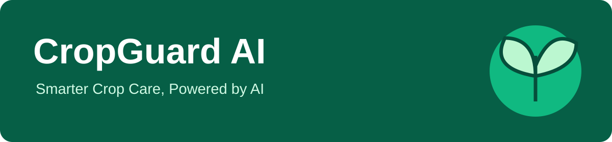
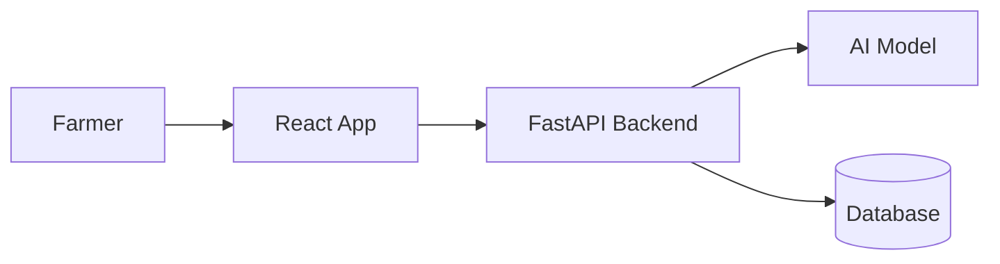


# 🌱 CropGuard AI

**Your smart farming companion.** An AI-powered application designed to help people understand crop health and manage crop care.

## ✨ Features
- 📸 AI-assisted crop disease identification from images
- 🌿 Crop-care information and management
- 🌦️ Weather-related information
- 📋 Crop health history
- 📱 Android application and responsive web interface
- 🌐 English, Hindi and Telugu support in development

## 🧑‍🌾 How It Works
1. **Upload a photo** of a crop.
2. **Let AI analyze** possible crop-health issues.
3. **Review the results** and available crop-care information.
4. **Track crop health** through the application.

## 🛠️ Technology
**Frontend:** React, TypeScript, HTML, CSS, Vite

**Backend:** Python, FastAPI, REST APIs

**AI:** Machine Learning, PyTorch

**Database:** SQL, TiDB

**Mobile:** Capacitor, Android

## 🧩 Architecture


## 💻 Run the Frontend
```bash
cd frontend
npm install
npm run dev
```

Backend and live integrations require their own configuration. Never commit real credentials.

## 🚧 Development Status
CropGuard AI is under active development. Android v1.2.0 is a signed packaging-verified test candidate. Phone testing, live Google Sign-In validation, and complete translations remain pending.

> ⚠️ AI predictions are not guaranteed diagnoses. Consult qualified agricultural experts for important crop decisions.

**🌍 Making agricultural technology more accessible, one crop at a time.**
